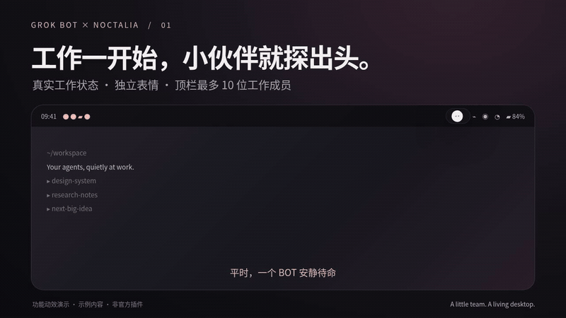
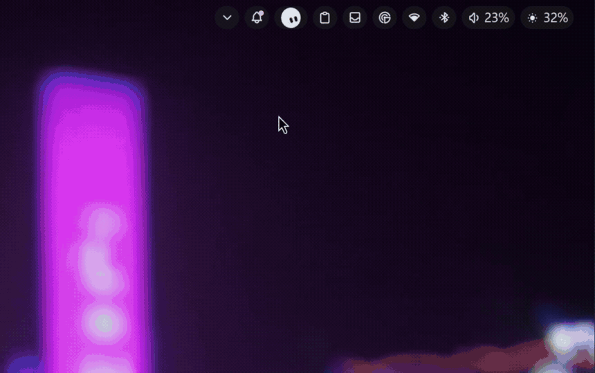
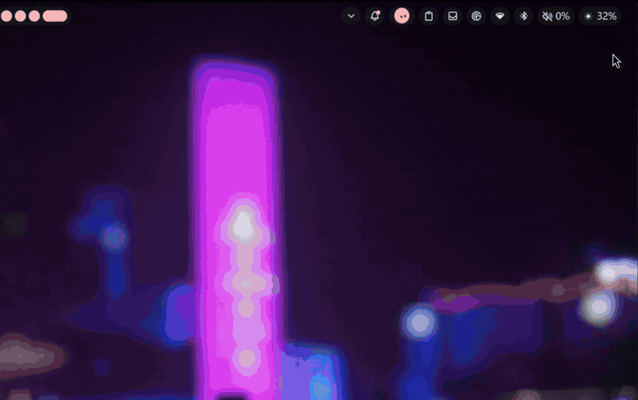

# Grok Bot Squad

给 Linux 状态栏养一队会动的 BOT。工作时探头，点头像聊天，再点收起。



- 独立眼神、眨眼和身体动画，26 种近似轮廓、11 种基础颜色。
- 面板底部“常驻设置”可点击头像选择始终显示的 BOT，选择会持久保存；常驻成员优先，其他工作成员自动出现。
- 顶栏最多显示 10 位成员；面板每页 32 位，每行 8 位，末行居中。
- 原地展开/收起聊天，Enter 发送，Shift+Enter 换行。
- 本地桥接随插件启动，通过应用已有发送队列提交消息。
- 插件内已读记录持久保存，新回复重新提示未读。

## 运行环境

Linux、niri、Noctalia（插件 API 32）、Node.js，以及已安装并登录的 Grok Bot 桌面应用。
这是依赖桌面 shell 的插件，不是独立聊天客户端。仓库及产品名称为 Grok Bot Squad。

## 安装

克隆仓库后运行：

```sh
./install.sh
```

然后在桌面 shell 的插件设置里启用 **Grok Bot**，将 face 小组件加入状态栏。
桥接默认随插件服务启动。如果原应用已经通过普通入口运行，请先自行退出应用再启用桥接。
脚本只复制插件，不修改桌面启动器或登录数据。

## 演示

真实桌面操作（无声循环动图）：






- [30 秒功能动画](demo/showcase-30s.mp4)
- [34 秒实机录屏](demo/real-desktop-demo.mp4)
- [工作成员探头](demo/01-peek-8s.mp4)
- [展开聊天](demo/02-chat-12s.mp4)
- [32 位成员排列](demo/03-squad-10s.mp4)

功能动画使用示例角色和消息；实机录屏保留原速，聊天区域已打码。动画工程在 demo/source。
没有上传用户聊天记录、登录状态、桥接 socket 或运行时数据。

## 桥接与限制

仅通过 Electron 调试管道连接本机应用，不开放 TCP 调试端口。
Unix socket 目录权限 0700，socket 权限 0600。发送请求验证成员和内容，并按请求 ID 去重。
“已提交”表示应用队列接收，不能视为服务器确认或 BOT 已回复；失败保留草稿，不自动重发。
依赖应用内部接口，应用升级可能需要适配。已读状态仅保存在插件内，暂不回写主应用。
通过本地持久文件读取最近 60 条消息；当前已读判定要求最新消息与成员摘要一致。
不要向他人分享运行时状态目录。

## 验证与许可

59 项插件逻辑自检通过，覆盖新回复、未读清除、布局和动画时钟等逻辑。
实机验证过桥接连接与状态读取；不保证所有系统和应用版本兼容。

MIT。原状态模型和表情基础来自 [omarchy-grok-bot](https://github.com/hmarquez-solutions/omarchy-grok-bot)，保留其版权声明。
非 xAI、Anysphere 或桌面 shell 官方产品。
